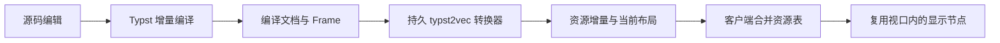

# 有状态预览 delta 的实现原理

本次核对：2026-10-23。需要区分增量编译、资源传输和显示复用三层状态。



## Tinymist / reflexo

`IncrSvgDocServer` 在当前源码中是 `IncrDocServer` 的别名。`pack_delta` 传输的是**矢量文档的二进制中间表示**，并非两份完整 SVG 字符串之间的文本差异。该协议可以服务不同显示方式；本机 Tinymist 0.15.10 的客户端实际同时使用 Canvas 和 SVG，不能把其性能全部归功于 SVG DOM diff。

服务端保留页面引用和 `IncrTypst2VecPass`。矢量内容通过 `Fingerprint` 引用；图形组记录子项及位置。因此，内容相同但位置改变时，存在复用内容、只更新布局/变换的空间，而不必重新传输所有轮廓。

`pack_delta` 会重置本轮 span 跟踪，推进资源寿命，回收超过保留窗口的旧资源，转换当前文档，提取新增资源，再序列化资源增量、回收清单和当前页面布局。**页面布局可以整份发送**；增量主要体现在资源内容无需重复发送，不代表包中的每项都是最小差异。

客户端 `IncrDocClient::merge_delta` 合并资源与字形等数据。SVG 客户端另外保存 `doc_view`（上一轮实际显示的页面）和 `glyph_window`（已提交到 DOM 的字形进度）。`render_in_window` 为视口外页面保留尺寸、用空页面占位；相同指纹的页面生成复用标记，变化页面继续比较图形组中的子项。匹配失败时可以重建。变化文字节点目前仍可能完整重建，不能保证改单个字符就只更新一个字符。

新客户端或需要重新同步时，必须提供足够重建状态的完整资源。Tinymist 区分 `diff-v1,` 与 `new,`；后者要求客户端先重置状态再合并。**合并尚未执行的渲染请求，与任意丢弃已经生成的 delta，是不同操作。** 后者可能使接收端缺少被后续引用的资源。

源码入口：

- [服务端打包和回收](https://github.com/Myriad-Dreamin/typst.ts/blob/main/crates/conversion/typst2vec/src/incr.rs)
- [客户端资源合并](https://github.com/Myriad-Dreamin/typst.ts/blob/main/crates/reflexo/src/vector/incr.rs)
- [SVG 客户端、页面复用和视口过滤](https://github.com/Myriad-Dreamin/typst.ts/blob/main/crates/conversion/vec2svg/src/frontend/incremental.rs)
- [图形组比较](https://github.com/Myriad-Dreamin/typst.ts/blob/main/crates/reflexo/src/vector/vm.rs)
- [Tinymist 完整与增量消息](https://github.com/Myriad-Dreamin/tinymist/blob/main/crates/typst-preview/src/protocol.rs)

`main` 链接供定位代码，后续实现可能变化；性能记录另有实测可执行版本号。

## 本项目的页级原型

暂不修改官方 `typst-svg`，不涉及上游改造。以整页为资源单元，用官方 `svg(&Page, &SvgOptions)` 独立导出。缓存指纹覆盖整个 `Page` 与导出配置。这比较保守，可能因源码元数据变化而多导出页面，避免只比较 Frame 的部分属性而漏更新。

简化消息如下（尺寸是示意值）：

```json
{
  "revision": 12,
  "base_revision": 11,
  "pages": [
    { "index": 0, "fingerprint": "a", "y_pt": 0, "width_pt": 595, "height_pt": 842 },
    { "index": 1, "fingerprint": "b", "y_pt": 852, "width_pt": 595, "height_pt": 842 }
  ],
  "changed": [{ "index": 1, "svg": "<svg>...</svg>" }]
}
```

`pages` 是完整页面清单，负责页数、删除、顺序和坐标变化；`changed` 只携带变化页。客户端保留其余页面内容与 DOM。

请求报告的是**已经安装的** revision。若客户端丢弃了后端生成的 revision 12，下次仍报告 11。后端发现与自己的缓存版本不匹配，就发送 `base_revision: null` 的完整页面快照；这可以复用缓存 SVG，不一定重新导出。

客户端还校验基准版本及页面完整性，校验失败时最多主动请求一次完整快照。编译失败不推进渲染缓存，界面保留最后成功版本，诊断单独更新。一次最多一个编译请求在途，等待期间的新源码只保留最后一份。

各页定义及本地引用加页前缀，避免插入同一 DOM 后冲突。隐藏 master 保留各页定义；聚焦块裁剪只引用相交页面，组合视图只引用视口附近页面并保留一页预取范围。资源定义仍全部驻留，**这不是整个 DOM/缓存的完全虚拟化**。

原型不复用变化页内部的子图形，也不跨页共享字形库，因此 delta 通常比 reflexo 大；优点是没有增加另一套渲染器及前端 WASM 协议，仍使用官方页面输出。

实现入口：`src-tauri/src/page_preview.rs`、`src/editor/pagePreview.ts`、`src/editor/usePreviewCompiler.ts`、`src/editor/SvgDocument.tsx`。实测结果与复现步骤见 [预览性能记录](preview-performance.md)。
